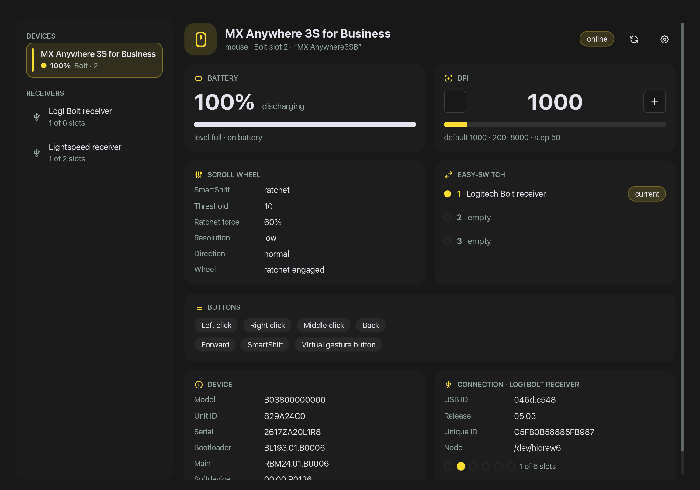

# logimouse

A command line tool that reads and changes Logitech mice and receivers on Linux by
talking HID++ to them over `/dev/hidraw`. It reports battery, DPI, report rate,
firmware, scroll wheel, Easy-Switch channels and buttons, and can change the DPI and
the report rate. It needs no kernel driver support, no daemon and no Python packages
beyond the standard library.

The repository also contains **Logi Mouse**, a [Noctalia](https://noctalia.dev) plugin
built on it: battery, charging state and DPI in the bar, and a panel with everything
else. See [`logimouse/README.md`](logimouse/README.md).



```
$ logimouse
MX Anywhere 3S for Business
  Connection:       Logi Bolt receiver, slot 2 (/dev/hidraw6)
  Unit ID:          829A24C0
  Firmware:         main: RBM24.01.B0006
  Battery:          90% (full), charging, external power: yes
  DPI:              800 (default 1000; supported 200–8000 in steps of 50)
  SmartShift:       ratchet, auto-switch threshold 10, ratchet force 60%
  ...
PRO X Wireless
  Connection:       Lightspeed receiver, slot 1 (/dev/hidraw16)
  Report rate:      1000 Hz (supported 125, 250, 500, 1000 Hz)
  Profile mode:     onboard (the mouse's stored profile sets report rate, ...)
  ...
```

## What it reads

| Device | Receiver |
| --- | --- |
| Name, type, friendly name | Name (Logi Bolt, Unifying, Lightspeed) |
| Model ID, unit ID, serial, firmware | USB ID, release, unique ID |
| Battery: percentage, level, charging, external power | Pairing slots: name, kind, WPID, unit ID, online |
| DPI: current, default, supported range | Paired devices and slot count |
| Report rate and onboard-profile mode | |
| SmartShift, high-resolution wheel | |
| Easy-Switch channels and their host names | |
| Buttons, and whether each is remapped or diverted | |

A device shows only what it supports: a gaming mouse such as the PRO X Wireless has a
report rate but no SmartShift or Easy-Switch.

Devices are found on Logi Bolt, Unifying and Lightspeed receivers, or connected
directly by USB. Tested with an MX Anywhere 3S for Business on a Bolt receiver and a
PRO X Wireless on its Lightspeed receiver and by cable.

## Requirements

- Linux, with Logitech devices exposed as `/dev/hidraw*` (any recent kernel)
- Python 3.10 or newer
- [uv](https://docs.astral.sh/uv/) to install it
- Read/write access to the devices' hidraw nodes (see [Permissions](#permissions))

## Install

```sh
./install.sh      # the logimouse and logi commands, plus the Noctalia plugin if Noctalia is installed
./uninstall.sh    # removes all of it
```

The commands go to `~/.local/bin` through `uv tool install --editable`, so edits to
the source take effect without reinstalling. `logi` is the same command as
`logimouse`.

When `noctalia` is on `PATH`, `install.sh` also registers this directory as the
plugin source `logimouse` and enables the plugin `cmoro-deusto/logimouse`. Adding the
widget to the bar is left to you, from Settings → Bar.

## Permissions

The user running `logimouse` needs read/write access to each device's hidraw node.
Desktop sessions often grant it for receivers already. For a device without it,
`logimouse` lists the node under "Not accessible" and reads the rest.

```sh
./grant-access.sh
```

It lists every Logitech device with its access and any udev rule that covers it, and
for the devices you pick adds either:

- a persistent udev rule in `/etc/udev/rules.d/70-logimouse.rules`, which gives the
  logged-in user access whenever the device is plugged in; or
- a temporary ACL on the current nodes, lost on unplug or reboot.

It shows what it will run and asks before each `sudo` step, and it can remove the
rules it added.

## Usage

### Report

```sh
logimouse            # every device and receiver, as text
logimouse --json     # the same, as JSON
```

### DPI

```sh
logimouse dpi        # current DPI and supported range
logimouse dpi up     # next supported step
logimouse dpi down   # previous supported step
logimouse dpi 1200   # an exact value
```

### Report rate and profile mode

```sh
logimouse rate               # current rate, supported rates and profile mode
logimouse rate up|down       # next or previous supported rate
logimouse rate 500           # an exact rate in Hz
logimouse mode               # onboard or host
logimouse mode host          # let the computer set the rate
logimouse mode onboard       # hand it back to the stored profile
```

On a mouse with onboard profiles, the profile stored on the mouse sets the report
rate, and the mouse refuses a change while it is in onboard mode. Host mode allows
the change, and turns the profile (its button assignments, DPI levels and lighting)
off until you switch back with `logimouse mode onboard`.

### Choosing a device

`dpi`, `rate` and `mode` act on the first device that supports them. To choose one:

```sh
logimouse --device 829A24C0 dpi up   # by the unit ID the report shows
logimouse --slot 2 dpi up            # by its receiver slot
```

### JSON

`--json` prints one document. The report has `devices` (each with a `connection`:
its receiver and slot, or `direct` with its USB ID), `receivers` and `inaccessible`.
A command prints its result, e.g. `{"ok": true, "unitId": "829A24C0", "previous":
800, "current": 850, "changed": true, ...}`. Errors are printed as
`{"ok": false, "error": "..."}` with exit code 1.

## Behaviour to know about

- **Changes do not persist.** DPI and report rate set from the computer are kept in
  the device's working memory, and can return to their defaults after the device
  powers off or reconnects.
- **Idle devices are slow to answer.** The first request to an idle wireless device
  wakes its radio, which takes up to about a second; `logimouse` waits up to 2.5 s
  for it. A device that is switched off or asleep deeply does not answer at all and
  is left out of the report; its receiver still lists its slot.
- **One run at a time.** Runs are serialized with a lock file
  (`$XDG_RUNTIME_DIR/logimouse.lock`). Receivers answer one request at a time, and
  HID++ replies carry too little to tell whose request they answer, so concurrent
  runs would read each other's replies. Other programs that talk HID++ to the same
  devices (Solaar, for instance) are not covered by the lock.
- **Traffic.** A full report sends about 60 small requests per device over the
  wireless link.

## Repository layout

| Path | What it is |
| --- | --- |
| `src/logimouse/` | The command line tool (one module) |
| `tests/` | Its tests, replaying HID++ replies recorded from real devices in `tests/fixtures/` |
| `logimouse/` | The Noctalia plugin, with its own README and tests |
| `install.sh`, `uninstall.sh` | Install or remove the commands and the plugin |
| `grant-access.sh` | Interactive hidraw permission setup |
| `docs/` | Screenshots for this README |

## Tests

```sh
make test
```

That runs:

1. the Python tests (`uv run pytest`), which replay HID++ replies recorded from an MX
   Anywhere 3S for Business and simulate direct, Lightspeed and gaming-mouse
   devices, so they need no hardware;
2. the plugin's model tests (`lua`, 5.4);
3. the plugin's static check against Noctalia's API definitions (`python3` 3.11+; the
   API part needs the network and is skipped without it).

## License

MIT, see [LICENSE](LICENSE). Not affiliated with or endorsed by Logitech.
